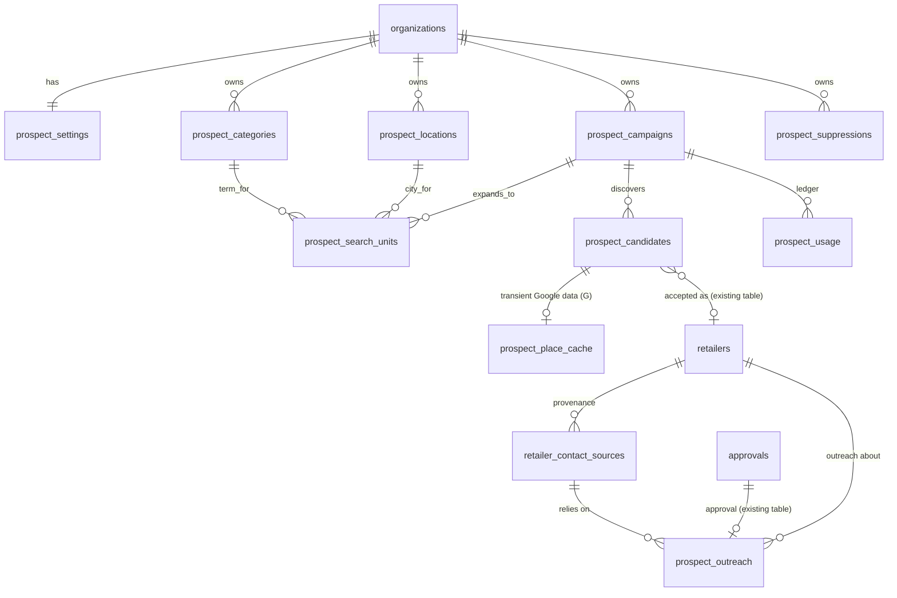

# Google Maps B2B lead generation: Phase 0 implementation readiness (PLANNING ONLY)

> **Update 2026-11-16:** the schema parts of this document are superseded in detail by `docs/GOOGLE_MAPS_B2B_PHASE1_SCHEMA_PROPOSAL.md` (ten tables in Migration A, three in a later Migration B, thirteen in all, plus one optional trigger in Migration X; signal words in code; keyed-hash suppression; corrected erasure and FR13 statements).


Status: **planning document. Nothing is built.** No code, migration, schema change, API connection, billing activation, commit, push or deployment accompanies it. It is the only file added in this task.
Source of truth: `docs/GOOGLE_MAPS_B2B_LEAD_GENERATION.md` (specification revision 2, with the section 11.3a outcome) and the roadmap amendment in `docs/FINAL_DELIVERY_ROADMAP.md` section J. Where this document and the specification differ, **the specification wins** and this document must be corrected.
Read for this plan: the specification; the roadmap; `docs/DATABASE.md` (an early draft, **superseded by the migrations** for table facts); the foundation and Amazon migrations; `docs/M5_*`; the existing B2B agent code paths named in specification section 1.1.
Labels: **(unverified)** marks any statement about Google, Supabase hosting features or Indian law that I have not confirmed against a live service or a current document. Every Google price, quota and term is unverified until Phase 8 and counsel (R1).

---

## 1. Final architecture

### 1.1 Components and data flow

```
 Browser (B2B Lead Agent page /b2b, new tabs)               Google (official Places API (New) only)
   |  campaigns | review | accept form | outreach            ^   Text Search, Place Details
   |  (acts as the signed-in user; no service-role key)       |   server-side, API key in host secrets only
   v                                                          |
 Next.js route handlers  src/app/api/prospecting/*            |
   deny(permission, req): 401/403/CSRF, demo-org refusal      |
   |                                                          |
   +--> runner (one bounded step per request, resumable)      |
   |      1. reserve budget  --(atomic, in DB)--> prospect_campaigns counters + prospect_usage
   |      2. kill switch + stop_all + cap checks  (refuse BEFORE any network call)
   |      3. Places client  ---------------------------------+   whitelist mapper -> GoogleTransient type
   |      4. results: Place ID -> prospect_candidates (class P)
   |                  all other Google fields -> prospect_place_cache (class G, expires <= 30 d)
   |      5. in-memory duplicate checks; only the LINK is stored
   |      6. scoring engine (pure functions) -> points + rule codes (class P)
   |
   +--> review / accept service (human only)
   |      HumanEnteredContact (never GoogleTransient) -> retailers + leads (existing path)
   |      + retailer_contact_sources (provenance + attestation) + agent_activity (ids only)
   |
   +--> outreach service: drafts from retailer + provenance only
          -> approvals (existing, type "B2B outreach") -> decide_approval() -> audit_log (existing)
          -> a PERSON sends outside the app and marks "Contacted"

 Supabase Postgres (RLS on every table)
   existing (unaltered): organizations, profiles, memberships, retailers, leads, tasks,
                         approvals, agent_activity, audit_log, customers, products, orders, content_items, amazon_*
   new (11): see section 3
   database-side jobs: private.purge_expired_place_cache()  <-- pg_cron hourly (needs R2 approval, section 7)
```

### 1.2 Fixed design rules
1. **Five agents, unchanged.** All work sits inside the B2B Lead Agent (agent key `b2b`). The orchestrator may read counts only; it runs no searches.
2. **Two data classes that never mix.** Class G (Google-sourced, transient) lives only in `prospect_place_cache` and short-lived page tokens. Class P (permanent) is everything else. Types enforce this in code, constraints and tests enforce it in the database (section 4).
3. **A person decides.** The system prioritises. Only a person accepts a candidate, and only a person sends a message.
4. **Nothing paid without approval.** `GOOGLE_PLACES_ENABLED` defaults to `false`; billing activation is a separate approval (R5).
5. **Additive only.** Existing tables, policies, functions and triggers are not modified. Rollback is dropping new objects (section 12).
6. **No Google content outside the cache**: not in activity text, approvals, tasks, drafts, logs, errors, exports or fixtures.

---

## 2. Existing versus proposed database components

| Component | Existing (verified in the migrations) | Proposed |
|---|---|---|
| Tenancy | `organizations`, `profiles`, `memberships`; helpers `private.role_in`, `is_member`, `can_write`, `can_decide`, `is_admin` | **Reuse unchanged** |
| CRM | `retailers` (no unique key beyond `(org_id, id)`), `leads` (composite FK keeps a lead in its organisation) | **Reuse unchanged**; created only on human acceptance; no Place ID column added |
| Approvals | `approvals` (`preview` and `meta` persist), `decide_approval()` (role check + `audit_log` row) | **Reuse unchanged** for outreach only. Optional later hardening trigger (R11) not adopted |
| Audit trail | `audit_log` (approval-only, append-only), `agent_activity` (append-only via `private.append_only()`) | **Reuse unchanged.** `agent_activity` is written with ids and fixed text only. `audit_log` is not used for candidates |
| Tasks | `tasks` | Reuse for follow-ups |
| Amazon | `amazon_*` (8 tables) | Untouched |
| New prospecting tables | none | **Eleven**, section 3 |
| New functions | `private.append_only()` exists | Proposed: acceptance RPC, decision RPC, budget-reservation RPC, purge function, purge-now RPC, scope-immutability and status-guard triggers |
| Scheduled jobs | none (no `pg_cron` use in any migration) | One hourly purge, **only after R2 approval** |

**Known gap, stated plainly.** The foundation insert policy on `retailers` lets any writer (staff and above) create a retailer directly through the existing API (`liveCreateRetailer`). The database therefore cannot stop a writer from typing Google-sourced details into a retailer by hand outside this module. The controls this module adds apply to the **acceptance path** (closed source list, reference, attestation, audit trail, refusal to pre-fill). Closing the wider gap would mean changing existing policies, which is out of scope. It is a residual risk for counsel to weigh (R1).

---

## 3. The eleven proposed tables and their relationships

All new, all proposals. No SQL is written. Class G = Google transient; class P = permanent.

| # | Table | Class | Parent(s) | Notes |
|---|---|---|---|---|
| 1 | `prospect_categories` | P | `organizations` | Categories, search terms, signal words; seeded with the eight categories |
| 2 | `prospect_locations` | P | `organizations` | Cities; seeded with the Madhya Pradesh list |
| 3 | `prospect_settings` | P | `organizations` (1:1) | cache days (1 to 30), caps, `stop_all`, retention periods, scoring version |
| 4 | `prospect_campaigns` | P | `organizations` | caps and **atomic counters** (`requests_used`, `cost_used`) |
| 5 | `prospect_search_units` | P (+ transient page token) | `prospect_campaigns`, `prospect_categories`, `prospect_locations` | term × location, progress, token nulled when done |
| 6 | `prospect_candidates` | P | `prospect_campaigns`, optional `retailers` | **`place_id`**, status, band, points and rule codes, `duplicate_of`, decision, **no Google text columns** |
| 7 | `prospect_place_cache` | **G** | `prospect_candidates` | whitelisted Google fields; `expires_at <= fetched_at + 30 days` |
| 8 | `retailer_contact_sources` | P | `retailers` | provenance; source type may not be `google_places` |
| 9 | `prospect_outreach` | P | `retailers`, `approvals`, `retailer_contact_sources` | the eight outreach states |
| 10 | `prospect_suppressions` | P | `organizations` | hashed phone, email, domain or Place ID |
| 11 | `prospect_usage` | P | `prospect_campaigns` | append-only usage ledger; no Google content |



Every table carries `org_id`, composite foreign keys to keep rows inside one organisation (the foundation pattern), RLS, a scope-immutability trigger and the indexes the dashboard needs. **Open design points to settle in the Phase 1 SQL proposal, not now:** (a) `prospect_candidates.duplicate_of` and `retailer_id` need composite keys; (b) the `place_id` unique key means a rejected Place ID is remembered; (c) reasons on candidates are a **closed code list with no free-text column** (a reviewer could paste Google text into free text, which would defeat the firewall). Free text appears only where it is the independent source reference, covered by the attestation.

---

## 4. Data lifecycle: Google transient cache versus permanent CRM

### 4.1 Lifecycle of one candidate

```
 Search result  --> Place ID stored (class P, permanent, place_id_checked_at)
      |             other fields --> prospect_place_cache (class G): fetched_at, expires_at (default +7 d, max +30 d)
      v
 Score computed from G fields --> points + rule codes stored (class P); Google text NOT stored
      |
      +-- Duplicate / Rejected(hard fact) / Insufficient / Needs review   (links and codes only)
      |
      v   (reviewer looks at Google Maps in Google's own interface and at the business's OWN channels)
 Approver enters independent details  --> HumanEnteredContact
      |        source type (closed list, no google_places) + reference + attestation + purpose + review_after
      v
 retailers + leads (existing path, stage new)  +  retailer_contact_sources  +  agent_activity (ids only)
      |
      v   (cache row expires or is purged; Place ID and decision remain)
 Class G deleted: hourly purge (R2), on-demand "Purge now", campaign deletion, erasure on request
```

### 4.2 What each class may do

| | Class G (transient) | Class P (permanent) |
|---|---|---|
| Contents | name, address, location, types, phone, website, rating, status; page tokens | Place ID; points and rule codes; statuses; links; config; counters; independent CRM details with provenance; outreach; suppressions |
| Table | `prospect_place_cache` and the token column only | all others, plus existing `retailers` / `leads` |
| Maximum life | 30 days (database check), default 7 | until deleted by the organisation or its review date |
| Shown in UI | only while fresh, with Google attribution and a Maps link | normally |
| May flow into class P | **never** | n/a |

### 4.3 Honest precision on expiry
The check constraint limits `expires_at`; it cannot delete rows. Between expiry and the next purge a row can still exist (up to one purge interval). Reads **ignore** expired rows, so the application never shows them, but they are physically present until the job runs. If counsel requires deletion at the instant of expiry, the purge interval must shrink or deletion must be done on read (R1/R2).

---

## 5. Google Places API dependency list

All items **(unverified)** until a current-document read and the Phase 8 capped live test.

| # | Dependency | Detail | Needed by |
|---|---|---|---|
| 1 | Google Cloud project owned by Cheri & Co./VEDASRI | R4 | Phase 8 |
| 2 | Billing account (India may require a verified or prepaid payment method) | R5 | Phase 8 |
| 3 | Places API (New) enabled; nothing else enabled | spec 5.8 | Phase 8 |
| 4 | Text Search (New): `POST /v1/places:searchText`, field mask required, about 20 results per page, paging to about 60 | spec 5.1 | Phases 3, 8 |
| 5 | Place Details (New): `GET /v1/places/{placeId}`, narrow mask | spec 5.2 | Phases 3, 8 |
| 6 | API key restricted to Places API (New); a static host IP may not exist, so quotas and monitoring compensate | spec 5.8 | Phase 8 |
| 7 | Quota caps at the pilot level in Google Cloud (budgets alone only alert) | R3 | Phase 8 |
| 8 | Budget alerts at 50, 80, 100 percent | R3 | Phase 8 |
| 9 | Hosting secret store for the key; rotation and revocation plan | spec 5.8 | Phase 8 |
| 10 | Terms: Place ID retention and refresh (about 12 months), lat/lng cache limit (about 30 days), prohibition on storing other content, attribution | R1 | Phases 1, 4 |
| 11 | Pricing and free allowance tiers (about US$32 to 35 per 1,000 searches, about US$20 per 1,000 details; recollection) | R3 | Phase 8 |
| 12 | Server environment variables: `GOOGLE_PLACES_ENABLED` (default `false`), `GOOGLE_PLACES_API_KEY` (placeholder name only in `.env.example`) | spec 5.7 | Phase 3 (placeholder), 8 (value) |
| 13 | No npm dependency expected: a small `fetch` client behind an interface | spec 5.10 | Phase 3 |

Phases 2 to 7 need **none** of items 1 to 9 and 11: they run on a fake transport and local PGlite.

---

## 6. Security and RLS implementation plan

### 6.1 Principles
No service-role key; the app acts as the signed-in user. Every table: RLS enabled, composite organisation foreign keys, a scope-immutability trigger (as M5), explicit grants. Server routes use `deny(permission, req)`; the new permission is `prospecting:run` (owner, admin); acceptance uses the existing decide roles.

### 6.2 Proposed policy matrix (to be refined in the Phase 1 SQL proposal and proven in PGlite)

| Table | Read | Insert | Update | Delete |
|---|---|---|---|---|
| categories, locations | member | admin | admin | admin |
| settings | member | admin | admin | none |
| campaigns | member | admin | admin, **but counters only through the reservation function** (column privileges) | admin |
| search_units | member | admin | admin | admin |
| candidates | member | admin (runner) | status and decision columns **only through the decision/acceptance RPCs** (approver+); no free-text columns | admin |
| place_cache | member | admin (runner) | admin | admin and purge functions |
| retailer_contact_sources | member | through the acceptance RPC; writers for later additions | none (append-only) | admin |
| outreach | member | writers | writers, with a state-transition guard trigger | admin |
| suppressions | member | writers | none | admin |
| usage | member | **reservation function only** | none (append-only) | none |

### 6.3 Database functions (proposed)
| Function | Security | Purpose |
|---|---|---|
| `accept_prospect_candidate(...)` | security definer, `search_path = ''`, `can_decide` check, one transaction | Creates retailer, lead, provenance and the activity row, and sets the candidate to accepted. All or nothing. Refuses without a source type from the closed list and an attestation |
| `decide_prospect_candidate(...)` | same | Reject, needs more info, undo duplicate; closed reason codes only |
| `reserve_prospect_request(...)` | same, `is_admin` | Increment-if-below-cap on campaign and organisation counters and write the ledger row in one statement; refuses at cap or when `stop_all` is on |
| `private.purge_expired_place_cache()` | security definer, EXECUTE revoked from public, anon, authenticated, service_role (the M5 pattern) | Deletes expired cache rows and expired page tokens; run by the scheduler only |
| `purge_prospect_cache_now()` | security definer, `is_admin` | "Purge now" for one organisation |
Triggers: scope immutability on every table; candidate status-transition guard (`accepted` requires a retailer, a decider with approval rights and a provenance row); append-only on the usage ledger; source-type check refusing `google_places`.

### 6.4 Application-layer controls
- `GoogleTransient` and `HumanEnteredContact` are distinct types; the acceptance service accepts only the latter.
- The Places host string is permitted only under `src/lib/prospecting/places`, enforced by a source guard test (as the Amazon one).
- No send APIs may exist anywhere in the module (source guard).
- Demo organisations: no Google call, ever; SAMPLE data and `SimBadge`.
- Errors and logs use fixed codes; no key, no Google text.

### 6.5 Residual risks (to be reported, not hidden)
1. Existing writers can create retailers directly (section 2).
2. A typed value cannot be technically proven independent of Google (spec 6.4).
3. PGlite proves SQL and RLS only. **Hosted RLS stays unverified until M1 staging resumes**, so Phase 1 output is labelled "local only".
4. Column privileges and `security definer` behaviour must be re-tested on hosted Supabase.

---

## 7. `pg_cron` purge implementation plan

**Precondition: R2 approval is adopted as a default, but creating the schedule needs its own migration and explicit go-ahead; nothing is scheduled by this document.**

| Step | Plan |
|---|---|
| 1. Function | `private.purge_expired_place_cache()` deletes `prospect_place_cache` rows where `expires_at <= now()` and clears expired `prospect_search_units` page tokens. Idempotent, set-based, returns only a count. Security definer with an empty search path and all EXECUTE revoked, as the M5 guard. |
| 2. Extension | `pg_cron` is an optional Supabase extension **(unverified: availability, schema and enable steps differ by plan and must be checked in the dashboard documents)**. It is not used by any existing migration. PGlite does not provide it. |
| 3. Schedule | Hourly, for example `select cron.schedule('prospect_cache_purge', '0 * * * *', 'select private.purge_expired_place_cache()');` **(unverified syntax and permissions)**. The job runs as the database's job role, so EXECUTE for that role must be confirmed on hosted Supabase. |
| 4. Observability | A read-only check (admin-visible) reporting the count of rows past expiry and the last purge time; an alert if rows older than two intervals exist. Reads already ignore expired rows, so a failed job degrades compliance timing, not correctness. |
| 5. Fallback | If `pg_cron` is unavailable or refused: **lazy purge** at the start of every prospecting request plus the admin "Purge now" button. This is already part of the design. |
| 6. Tests (local) | Seed rows with past, near and future expiry; assert only expired rows are deleted; assert the function is not callable by `authenticated`, `anon`, `service_role`; assert the 30-day check refuses longer expiries; assert idempotence and that other tables are untouched. |
| 7. Tests (hosted, staging only, later) | Job exists, runs on schedule, deletes a seeded expired row, and the failure alert works. **Cannot be proved locally.** |
| 8. Rollback | `select cron.unschedule('prospect_cache_purge');` then drop the function. |
| 9. Interval decision | Hourly is a default; if counsel requires tighter deletion, shorten (R1). |

---

## 8. Campaign execution and spending-control architecture

### 8.1 Execution
A campaign expands to **search units** (term × city). The browser calls `POST /api/prospecting/campaigns/:id/run`; each call executes **one bounded step** and returns `done`, `more`, `waiting` or `failed`. One active run per campaign (partial unique index, as M5). A page token lives only until the unit completes or expires. Progress survives a closed browser. No background infrastructure is needed for searching.

### 8.2 The refusal chain (evaluated before **every** network call, in this order)
1. Organisation is not a demo organisation.
2. `GOOGLE_PLACES_ENABLED` is `true` (default `false`).
3. Organisation `stop_all` is off; campaign is running, not paused.
4. The caller has `prospecting:run`.
5. `reserve_prospect_request` succeeds: campaign request cap, campaign cost cap, organisation monthly cap not yet reached (atomic increment-if-below-cap, with the ledger row).
6. Only then is the call made.

Every attempt that passes step 5 is **counted even if the call fails** (conservative over-counting; Google billing for failed requests is unverified). There is no refund path in version one.

### 8.3 Three cap layers
| Layer | Mechanism | Stops spending? |
|---|---|---|
| Application | per-campaign and monthly caps, atomic reservation | Yes (before the call) |
| Google Cloud | API **quota** caps at pilot level | Yes (Google refuses) |
| Google Cloud budget | alerts at 50/80/100 percent | **No, alert only** |

### 8.4 Estimate, monitor, stop
- **Estimate** shown before Run: maximum requests and estimated cost against remaining budget, using versioned, editable price configuration (Phase 8 replaces assumed prices with observed ones).
- **Monitor:** the usage ledger feeds the Performance tab; cap status always visible.
- **Emergency stop:** campaign Pause; organisation-wide **Stop all** (effective before the next call); environment switch.
- **No numbers are invented:** caps ship **empty or zero**, so nothing can run until a person sets them from R3.

### 8.5 Concurrency test intent
Two concurrent runs with one request of headroom must produce exactly one reservation (section 10).

---

## 9. Lead qualification and human review workflow

### 9.1 Roles
| Step | Who |
|---|---|
| Create/run campaign, settings, Stop all, Purge now | owner, admin (`prospecting:run`) |
| Review notes and drafts | staff and above |
| Accept, reject, request more information, undo a fuzzy duplicate | owner, admin, approver |
| Approve outreach | existing Approvals roles |
| Send a message and mark "Contacted" | **a person, outside the app** |

### 9.2 Flow
1. Candidates appear with a priority band (High 55 and above, Medium 35 to 54, Low under 35; placeholders to be calibrated in the pilot), per-criterion points and flags.
2. The reviewer opens the business on Google Maps (their own link) and the business's **own** website or page.
3. To accept, the approver enters details **from an independent source** (closed list, reference, attestation, purpose, review-after date). The form never pre-fills from Google.
4. Acceptance is one database transaction (retailer, lead, provenance, activity row). No independent source means no acceptance; the candidate stays "Needs more information" and its Google data expires.
5. Rejection and "needs more info" use closed reason codes. A rejected Place ID is remembered.
6. Outreach drafts use the retailer record and its provenance only; suppression and consent checks run first; the draft goes through the existing approval queue; a person sends and records it.

### 9.3 Guarantees
Automation sets only Needs Review, Insufficient Information, Duplicate, and Rejected on a **hard verified fact** (permanently closed, outside configured locations). It never sets "Qualified", never rejects on a name or score, never fills a gap. The ceiling for an unreviewed candidate is 77.

### 9.4 Capacity reality
Review time is the binding constraint (spec 9.3). Planning figures stay at about 10 to 40 accepted leads per week during an expansion wave and under 10 between waves; 50 to 100 per week is tracked as **total qualified leads from all sources**, not as a Places promise. The pilot (Phase 9) replaces every assumption with a measurement. R6 supplies the actual capacity.

---

## 10. Testing strategy

Every phase ends with the **whole** Vitest suite, `tsc`, `eslint` and the build green. Tests run locally on PGlite (real foundation and Amazon SQL) and a fake Places transport. **No live Google call before Phase 8.** Each new test family gets a **mutation check** (break the rule, confirm a test fails), as done for M5.

| Family | What it proves |
|---|---|
| Scoring | one test per rubric cell and cap; the 77 ceiling; outcome order; no auto-qualify; no inference-based auto-reject; unknown earns 0; determinism; the four worked examples |
| Mappers | whitelist only; missing fields stay unknown; unexpected fields dropped; no throw on partial data |
| Places client (fake transport) | no call when disabled, at cap, stopped, or demo; retry and no-retry rules; quota and 429 handling; no key or Google text in errors or logs; host confined by a source guard |
| Schema (PGlite) | RLS role matrix per table; cross-organisation isolation; `(org_id, place_id)` uniqueness; 30-day expiry check; `google_places` refused as a source; scope immutability; status-guard trigger; usage append-only; counters cannot exceed caps; forward-only; **existing tables' DDL unchanged** (snapshot of `information_schema` and `pg_policies` for existing tables before and after) |
| Functions | acceptance atomicity (all or nothing); refusal without source and attestation; decision roles; reservation atomicity; purge deletes only expired rows; EXECUTE privileges as the M5 guard test (with default privileges emulated so tests are not vacuous) |
| Concurrency | two simultaneous reservations with one unit of headroom: exactly one succeeds |
| Resumability | re-run is idempotent; resume continues from the stored unit |
| UI/API | permissions, CSRF, viewer read-only, attribution shown, demo labelling, SAMPLE only |
| Guards | no send APIs; Places host only under `src/lib/prospecting/places`; no key in client bundle |
| Regression | existing retailer, import, pipeline, approvals, M2 to M5 tests unchanged |

### 10.1 The data-taint test (R-d), in detail
1. Choose a unique sentinel per run (for example a random token embedded in a fake business name, phone and website).
2. Run the **complete** flow with the fake transport returning that sentinel: search, duplicate check, details, scoring, review, an acceptance with human-entered details, outreach draft, approval, activity, a task, an export path if one exists.
3. Dump **every table** in the `public` schema as text and search for the sentinel. Pass only if it appears **in `prospect_place_cache` (and the in-flight token column) and nowhere else**, including `approvals.preview/meta`, `agent_activity`, `tasks`, `retailers`, `leads`, `prospect_outreach`, candidates and the ledger.
4. Also search captured logs, error messages, non-review API responses and generated drafts.
5. Purge the cache; the sentinel must now appear **nowhere**.
6. **Mutation check:** deliberately write a Google name into an activity row; the test must fail.
7. A reviewer-typed value must be representable only as `HumanEnteredContact`; a type-level test proves `GoogleTransient` cannot be passed to the acceptance service.
Limit: this proves the code paths tested, not a human re-typing Google content (section 6.5).

---

## 11. Implementation phases, dependencies and acceptance criteria

Numbering follows the specification. The **recommended order** is in section 13.

| Phase | Scope | Depends on | Measurable acceptance criteria |
|---|---|---|---|
| **0** Readiness | This document, blocker register, sequence | spec rev 2 | Document exists; each of R1, R3, R4, R5, R6 has owner, evidence, impact and blocked phase; git shows only docs added |
| **1** Schema | SQL proposal document; then one local migration file; **not applied** | **R1** | Eleven tables in the proposal match the migration file byte for byte; every new table has RLS and a role-matrix test; DDL snapshot of existing tables identical; expiry, source-type, uniqueness, immutability, append-only and cap checks each have a passing test and a mutation check; forward-only; zero hosted changes |
| **2** Scoring | Pure rubric, bands, hard-fact rules, normalisers, versioned config | 0 | Every rubric cell and cap has at least one test; ceiling 77 asserted; outcome order asserted; each of the four examples reproduces its stated total; breaking any weight fails at least one test |
| **3** Places client | Interface, field masks, whitelist mappers, fake transport, throttle, redaction, kill switch | 0 | No network call occurs when disabled, capped, stopped or demo (asserted on the fake transport); source guard fails if the host appears elsewhere; no key or Google text in any captured log or error |
| **4** Runner and persistence | Units, resumable steps, atomic reservations, duplicate checks, cache, purge function | 1, 2, 3 | Concurrency test passes; re-run idempotent; purge deletes only expired rows; **taint test passes with its mutation check**; demo orgs make zero calls |
| **5** Review and acceptance | Review queue logic, independent-details form, acceptance RPC and service, provenance | 4 | Non-approvers cannot accept; acceptance without source or attestation fails; failure mid-way leaves no partial rows; Google text absent from `retailers`, `leads`, `agent_activity`; existing retailer and import tests unchanged |
| **6** Dashboard | `/b2b` tabs, campaign form, progress, performance, settings, Stop all, Purge now | 4, 5 | Component and API tests for each tab; viewer read-only; attribution displayed with fresh Google fields only; demo labelling present |
| **7** Outreach and approvals | Drafts from retailer and provenance, suppression, eight states, approvals integration, erasure | 5 | Existing approvals tests unchanged; suppression blocks drafting and approval; draft builder cannot import Google types (source guard); no send API exists; erasure removes retailer, lead, provenance, links and outreach, and a suppression is recorded |
| **8** Live connection test | A handful of capped real calls; contract document | **R3, R4, R5**, phases 3, 4 | Spend recorded in the ledger and the Google console and within the approved cap; contract document records actual endpoints, tiers, limits and field behaviour; all captured responses git-ignored and deleted; no secret in git |
| **9** Pilot and UAT | One campaign, two cities; measure yield | 8, **R6** | Signed-off figures: candidates reviewed, acceptance rate, minutes per review, independent sources per accepted lead, cost per accepted lead; target and bands revised from them |

**Hosted verification:** staging only, after M1 resumes (R12 deferred). Until then every database result is labelled "local only, hosted unverified".

---

## 12. Rollback and failure handling

### 12.1 Rollback
| Item | Rollback |
|---|---|
| Application code | Revert the feature branch; the module is additive. `GOOGLE_PLACES_ENABLED=false` disables all Google behaviour immediately without a deploy |
| Migration | Because every object is new, rollback is **drop in reverse dependency order**: scheduler job, functions and triggers, then the thirteen tables (see the proposal, section 18, for the tested order: X, then B, then A). Purge the cache first so no Google data lingers. Existing tables need no repair (none were altered). Written and rehearsed in PGlite in Phase 1 |
| `pg_cron` | `cron.unschedule(...)` then drop the function |
| Key | Revoke in Google Cloud; remove from host secrets |
| Billing | Disable the API, set quota to zero, close the budget; billing deactivation is the owner's action |

### 12.2 Failure handling
| Failure | Handling |
|---|---|
| Google 429, 5xx, timeout | Bounded retries with back-off shown as `waiting`; attempts count toward caps; run returns `failed` with a fixed code after the limit |
| Quota exceeded or key revoked | Run stops; campaign marked paused with a fixed reason; no automatic retry |
| Cap reached mid-run | Run stops cleanly; progress kept; resumes only after a person raises the cap |
| Google response shape changes | Unknown fields dropped; missing fields are unknown; contract check in Phase 8 and a version note |
| Purge job fails or `pg_cron` unavailable | Reads ignore expired rows; admin alert; lazy purge and "Purge now" fallback |
| Acceptance interrupted | Single transaction: all or nothing |
| Taint test fails | **Release blocker**; no phase after it proceeds |
| Counsel rules against derived scores | Fallback: store band and total only, then Place ID and decision only; the review queue shows live (fresh) data and never persists reasons |
| Counsel rules against Place ID retention | Fallback: store a one-way hash for de-duplication only, or re-discover each time at cost |
| Counsel rules a typed-from-Google value is not independent | Acceptance requires a third-party-verifiable reference type; unsupported cases stay "Needs more information" |
| Google terms change | Treat as an R1 re-review; module stays off until reviewed |
| Spend anomaly | Stop all; quota to zero in Google; review the ledger against the Google console |
| Reviewer capacity short | Queue grows; nothing is auto-accepted; unreviewed candidates expire to Place ID only |

---

## 13. Smallest safe implementation sequence

### 13.1 Recommended order
**0 → 2 → 3 → (gate: R1) → 1 → 4 → 5 → 7 → 6 → (gate: R3 + R4 + R5, each separate) → 8 → (gate: R6) → 9**

Reasoning: scoring and the Places client are pure code, need no database and no clearance, and de-risk the rest. The schema, which stores derived scores and provenance, waits for the legal read. Outreach (7) precedes the full dashboard (6) so the whole trust chain is tested before the UI wraps it; either order is safe.

### 13.2 Separation of work

| Track | Work | Needs | Safe now? |
|---|---|---|---|
| **A. Mocks and local tests only** | Phase 2 scoring; Phase 3 client with fake transport, mappers, field masks, cost estimator, kill switch; runner state machine against an in-memory repo; the type separation (`GoogleTransient` / `HumanEnteredContact`) | Phase 0 approval only | **Yes**, once you approve starting it |
| **B. Needs legal clearance (R1)** | Phase 1 schema and migration file; storing derived points and rule codes; provenance and acceptance design; Place ID retention and refresh; the purge interval; outreach consent wording | Counsel's written view | **No, wait** |
| **B2. Local after R1, no external access** | Phases 4, 5, 6, 7 on PGlite and the fake transport | R1, Phase 1 | After R1 |
| **C. Needs Google Cloud access and money** | Phase 8 live test: project, API enablement, key, quota, budget alerts, billing | R3, R4, R5 (all separate) | **No** |
| **D. Needs real reviewers** | Phase 9 pilot and UAT; calibration of bands and the target | R6, Phase 8 | **No** |
| **E. Needs hosted Supabase** | Hosted RLS verification; `pg_cron` schedule proof | M1 staging (R12), R2 go-ahead | **No, deferred** |

Track A work has one safeguard: scoring's output type keeps "persist codes" behind a setting so the R1 fallback (band and total only) needs no rewrite.

---

## 14. Blocker register

| ID | Blocker | Owner | Required evidence | Impact if unresolved | Blocks |
|---|---|---|---|---|---|
| **R1** | Written legal review: Google data retention (Place ID retention and refresh, cache limits, attribution), derived scores, the independent-source and attestation rule, and Indian data-protection and messaging requirements (DPDP Act 2023 and rules; commercial-communication and WhatsApp business policy rules; all unverified) | Cheri & Co./VEDASRI, through its owner (Abhishek Pathak) appointing counsel; **counsel not yet named** | A written opinion from a named adviser answering the five questions in spec 11.3 (R1), dated, with any conditions; stored outside git if privileged, with a summary note in `docs/` | Schema might store something not permitted; whole data design may change (fallbacks in section 12.2) | **Phase 1** and everything after it; outreach consent wording (Phase 7) |
| **R3** | Pilot budget, per-campaign cap, monthly cap, Google quota level | Owner of Cheri & Co./VEDASRI (budget holder) | The three numbers and currency in writing; the quota values to be configured in Google Cloud; confirmation they cover the pilot estimate (about US$3, assumption) | Caps cannot be configured; the runner has no safe limits and must stay disabled | **Phase 8** (also the real values in Phase 6 settings) |
| **R4** | Named Google Cloud project and billing owner at Cheri & Co./VEDASRI, plus a named technical contact to be granted temporary roles | Cheri & Co./VEDASRI | The owner's name and role; project identifier created under the company, not a personal account; the named technical contact; list of granted roles and their removal date | No project, no key, no quotas | **Phase 8** |
| **R5** | Explicit **billing activation** approval, kept **separate** from every other approval | Cheri & Co./VEDASRI billing owner, with your approval in chat | A dated, explicit written approval naming the project and the cap; **it cannot be inferred from R3 or R4 or from this plan** | Any live call would be unauthorised spend | **Phase 8** (and therefore 9) |
| **R6** | Named reviewers and weekly review capacity | Cheri & Co./VEDASRI | Named people with roles (approver or above to accept), weekly hours committed | The review queue has no one to clear it; volume and the pilot measurements are meaningless | **Phase 9**; also sizing for Phases 5 and 6 |

Other open items (not blockers for Phase 1): R2 (schedule approval, adopted as a default, needs its own go-ahead when the migration exists), R7 (`trade_directory_permitted` disabled until confirmed), R8 (click-to-chat off), R11 (not adopted), R12 (M1 staging deferred).

---

## 15. Verification status
- **Nothing is built, connected, billed or tested.** No Places call has been made; no key or project exists.
- No existing file other than the two documentation changes recorded earlier has been touched; this task adds only this document.
- Google and Supabase feature statements, prices, quotas, terms and Indian law remain unverified. The rubric, bands, funnel numbers and effort assumptions are assumptions, not measurements.
